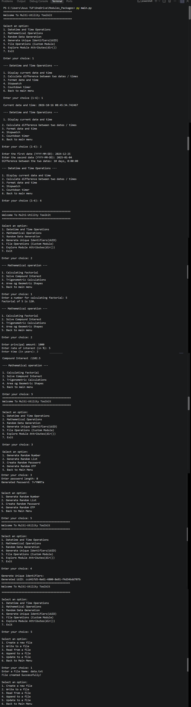

# 🐍 Multi-Utility Toolkit

## 📌 Subtitle of the Project

A simple Python project that performs datetime operations, mathematical calculations, random data generation, and UUID generation using Python's built-in modules.

## 📖 Project description

This project is a beginner-friendly Python program that provides an interactive, menu-driven interface to perform multiple utility operations.

The program allows users to select from the following options:

- 🕒 Perform datetime and time operations.
- 🧮 Perform mathematical calculations.
- 🎲 Generate random numbers, shuffle lists, create passwords, and generate OTPs.
- 🆔 Generate unique identifiers using UUID version 4.

The project uses Python's built-in modules, including `datetime`, `time`, `math`, `random`, `uuid`, and `string`.

The program uses functions, loops, and conditional statements to organize different operations. It continues displaying the menu until the user chooses to return to the main menu.

## ✨ Features

- 📋 Displays an interactive menu.
- 🕒 Displays the current date and time.
- 📅 Calculates the difference between two dates.
- ⏰ Formats dates and times.
- ⏱️ Provides stopwatch functionality.
- ⏳ Provides a countdown timer.
- 🔢 Calculates the factorial of a number.
- 💰 Calculates compound interest.
- 📐 Performs trigonometric calculations using sine and cosine.
- ⭕ Calculates the area of a circle.
- ▭ Calculates the area of a rectangle.
- 🎲 Generates random numbers.
- 🔀 Shuffles a predefined list of numbers.
- 🔐 Generates random passwords.
- 📱 Generates random OTPs.
- 🆔 Generates unique identifiers using UUID version 4.
- 🔁 Uses a menu-driven interface to navigate between operations.

## 📚 Concepts Used

- Variables and data types.
- User input and output.
- Type conversion using `int()` and `float()`.
- Functions and function calls.
- Built-in modules and imports.
- The `datetime` module.
- The `time` module.
- The `math` module.
- The `random` module.
- The `string` module.
- The `uuid` module.
- Date and time formatting using `strftime()`.
- Date parsing using `strptime()`.
- Calculating differences between dates.
- Measuring elapsed time.
- Countdown using `while` loops.
- Mathematical calculations.
- Random data generation.
- Conditional statements using `if`, `elif`, and `else`.
- Loops and menu-driven programming.

## ⚙️ Built-in Functions and Methods Used

- `print()`
- `input()`
- `int()`
- `float()`
- `datetime.now()`
- `datetime.strptime()`
- `strftime()`
- `time.time()`
- `time.sleep()`
- `math.factorial()`
- `math.radians()`
- `math.sin()`
- `math.cos()`
- `random.randint()`
- `random.shuffle()`
- `random.choices()`
- `random.randrange()`
- `str.join()`
- `uuid4()`
- `break`

## 🛠️ Technologies Used

- Python
- Visual Studio Code (VS Code)
- Git
- GitHub

## 🚀 How to Run

### Step 1: Install Python

Download and install Python from the official website:

https://www.python.org/downloads/

### Step 2: Install VS Code

Download and install Visual Studio Code:

https://code.visualstudio.com/

### Step 3: Open the Project

Open the project folder in Visual Studio Code.

### Step 4: Run the Program

Open the terminal in the project directory and execute:

```bash
python main.py
```

## 📂 Project Structure

```
Multi-Utility-Toolkit/
│
├── packages/
│   ├── __init__.py
│   ├── explore_module.py
│   ├── file_utils.py
│   └── math_utils.py
│
├── main.py
├── output.png
├── README.md

```
## Output


## 🎯 Learning Objectives

By completing this project, you can learn:

- How to use Python's built-in modules.
- How to create functions and call them.
- How to perform date and time operations.
- How to calculate mathematical values.
- How to generate random numbers, passwords, and OTPs.
- How to generate unique identifiers using UUID.
- How to use loops and conditional statements.
- How to build an interactive, menu-driven application.
- How to organize Python code into reusable functions.
- How to run and manage a Python project using VS Code, Git, and GitHub.

## 👩‍💻 Author / Developer

**Pansuriya Princy**